# fastQML

A small PyTorch quantum-circuit simulation toolkit for batched state-vector simulation of
parametric circuits, built around three ideas:

1. **Windowed Kronecker application.** A layer of single-qubit gates is the Kronecker product of
   those gates. Instead of materialising the full `2^n x 2^n` operator, the product is split by the
   mixed-product property into windows of at most 7 qubits, `U = (U_0..6 ⊗ I)(I ⊗ U_7..13)...`, and
   each window is one batched matmul over a reshape of the state — no permutes, cost `B·2^n·2^7`
   per window instead of `4^n`.

2. **Time fusion of gate sequences.** `compile_sequence` walks a circuit in time order and merges
   consecutive gates whose qubit ranges fit in a window into one dense window operator, whether or
   not they commute. A 14-qubit layer of RY+RZ on every qubit, a 13-gate CRY chain and a Toffoli
   becomes **4 passes** over the state (the per-gate approach needs 42).

3. **A one-pass Triton window kernel.** Applying a window with cuBLAS takes ~10 state-sized
   reads/writes (four real GEMMs plus epilogues); `fastqml.window_triton` reads `re`/`im` once,
   does the complex product in registers with `tl.dot`, and writes once — ~1.4 TB/s effective on an
   RTX 5090, the practical memory ceiling. The adjoint reuses the same kernel; the gate gradient is
   a cuBLAS reduction over the state.

All state tensors stay real `(re, im)` pairs, so everything is `torch.compile`-safe and captures
cleanly into CUDA graphs.

On an RTX 5090, forward+backward of the circuits below runs **1.6-10x faster than PennyLane +
JAX on the same GPU** (jit + vmap, TF32 on for both), with 2-5x less memory — see
[Benchmarks](#benchmarks).

---

## What's in here

| File | Purpose |
|---|---|
| `fastqml/gate_fusion.py` | Gate matrix builders (RX/RY/RZ/Rot/PhaseShift, X/Y/Z/H/S/T, CRX/CRY/CRZ/CPhase/IsingXX/YY/ZZ, CNOT/CY/CZ/SWAP/ISWAP, Toffoli, CSWAP), windowed layer application, edge-colouring plans for 2-/3-qubit layers, diagonal-layer builders, and `compile_sequence` / `apply_sequence` time fusion |
| `fastqml/window_triton.py` | Optional Triton kernel behind every window apply on CUDA fp32: one read + one write of the state per window for the forward and the adjoint, plus the gate-gradient reduction; TF32 or three-pass TF32 (`tf32x3`, fp32-class accuracy) following `torch.backends.cuda.matmul.allow_tf32` |
| `fastqml/torch_sim_real.py` | Raw per-gate kernels in `(B, 2, 2, ..., 2)` state layout, plus state-utility helpers, block-encoding subroutines, and the Hadamard-test overlap primitive |
| `fastqml/register_ops.py` | Multiplexed (address-controlled) rotations for single large registers — angle indexed by computational-basis address bits — with optional Triton kernels (autograd included), pure-torch fallback, and dense composition helpers (`compose_dense` / `apply_dense`) |
| `fastqml/circulant.py` | Translation-equivariant circulant layers for lattice registers: momentum-block operators `M = F' (sum_k U(k)) F` as dense matrices or FFT-style applies |
| `examples/minimal_cuda_graph_model.py` | `TinyVQC`, a variational-circuit `nn.Module` (time-fused by default, per-layer API optional), plus benchmarks for CPU eager / CPU `torch.compile` / CUDA eager / CUDA graph / PennyLane `lightning.qubit` |
| `examples/register_ops_bench.py` | Benchmarks for the multiplexer (Triton / eager / per-batch chain), circulant applies, and dense composition |
| `test_pennylane_equivalence.py` | 40 numerical equivalence tests against PennyLane `default.qubit`: every gate, multi-pair colours, chain ordering, windowed layers above the window size, the permute fallback, diagonal layers, time-fused sequences, per-batch chains. All at the fp64 noise floor (max diff = 0 or ~1e-17) |
| `test_window_triton.py` | The Triton window kernel against the cuBLAS window path (fp32 CUDA): forward, adjoint and gate gradient, at fp32 and TF32 |
| `test_register_ops.py` | 15 numerical tests: multiplexers vs explicit dense references at fp64, Triton forward/backward vs eager autograd, circulant unitarity / dense-vs-k-space equality / translation equivariance |

### Which API should I use?

For a parametric circuit on up to ~16 qubits, **`gate_fusion.compile_sequence` + `apply_sequence`**:
list the gates in time order once (in `__init__`), hand it the gate matrices every forward. It
fuses across gate types and across layers of your circuit and is the fastest path at batch sizes
above a few dozen. The per-layer functions (`apply_su2_layer`, `compute_two_qubit_plans` +
`apply_disjoint_two_qubit_layer`, ...) remain for simple circuits and tiny batches, where the
fused window operators cost more to build than the passes save; both are exact to round-off.

Standalone diagonal layers (RZ, PhaseShift, CPhase, IsingZZ, CZ) are one elementwise pass with the
`build_*_diag` builders and `apply_diagonal_layer`. A RZ that follows a RY on the same qubit is
cheaper folded into the 2x2 (`build_ry_rz_gates`).

**Reach for `fastqml.torch_sim_real`** when one of these applies:

- **One-off single-gate ops.** `apply_ry(re, im, theta, qubit, nq)` etc. apply one gate directly via `movedim` + stack ops — fewer launches when the work isn't layer-shaped.
- **State / amplitude / probability conversion.** `_amp_to_state_real(amp, nq)` initializes the `(B, 2, 2, ..., 2)` state from an amplitude vector. `_state_to_probs_real(re, im)` flattens `|ψ|²` to a probability vector. `_renormalize_real(re, im, nq)` re-normalizes after non-unitary operations.
- **Block-encoded operators.** `apply_block_encoding_real(...)` and `apply_block_encoding_complex(...)` post-select an ancilla qubit to encode a learnable sub-norm-1 linear operator.
- **Hadamard test for overlaps.** `hadamard_test_overlap(re_Q, im_Q, re_K, im_K, nq)` returns `Re<ψ_Q | ψ_K>` via the standard 1-ancilla Hadamard-test circuit.

**Reach for `fastqml.register_ops` / `fastqml.circulant`** when your model is a *single large register* rather than many small ones — e.g. a lattice register where sites are basis states. `register_ops` provides the multiplexed rotation (angle indexed by basis-address bits — the uniformly controlled rotation of circuit synthesis); `circulant` provides translation-equivariant lattice layers; combined with `compose_dense` for parameters that are static across many evaluations, whole gate cascades collapse to one matmul per block.

---

## Installation

### Python packages

For NVIDIA GPUs (Windows/Linux), pin a CUDA-matched PyTorch wheel first:

```bash
pip install torch --index-url https://download.pytorch.org/whl/cu128
```

(Use `cu124` / `cu121` / etc. for older CUDA toolkits, or skip this and let `pip install fastqml` pull the default wheel for CPU / Apple silicon.)

Then install fastqml:

```bash
pip install fastqml
# or directly from GitHub for the latest:
pip install git+https://github.com/ereinha/fastQML.git
```

For editable / contributor install:

```bash
git clone https://github.com/ereinha/fastQML.git && cd fastQML
pip install -e .          # core
pip install -e .[test]    # also install pennylane + pennylane-lightning for the equivalence tests
```

The core toolkit needs only torch + numpy. PennyLane is an optional dep used for `test_pennylane_equivalence.py` and the PennyLane row in the example benchmark.

> **Triton.** Not a dependency, but strongly recommended on CUDA: when `triton` is importable,
> every window of 4-7 qubits runs through the one-pass kernel in `fastqml.window_triton` (2-5x
> less memory traffic than the cuBLAS path), and `fastqml.register_ops` uses Triton for its
> multiplexed rotations. Without it everything falls back to cuBLAS / pure torch. On Linux/macOS
> Triton ships transitively with `torch`; on Windows `pip install triton-windows` (pick the
> release matching your torch, e.g. `triton-windows==3.6.*` for torch 2.11). Set
> `gate_fusion.USE_TRITON_WINDOW = False` to force the cuBLAS path.

### C++ compiler (only needed for `torch.compile` on CPU)

CUDA users don't need any compiler — `torch.cuda.make_graphed_callables` works out of the box.

For CPU `torch.compile`, Inductor calls a C++ compiler to emit fused kernels.

**Linux** — install GCC if you don't have it:

```bash
sudo apt install build-essential          # Debian/Ubuntu
sudo dnf groupinstall "Development Tools" # Fedora/RHEL
```

**macOS** — install the Xcode Command Line Tools:

```bash
xcode-select --install
```

This puts `clang`/`clang++` on PATH; PyTorch picks them up automatically.

**Windows** — install Visual Studio 2022 Build Tools' C++ workload:

```powershell
winget install Microsoft.VisualStudio.2022.BuildTools --override `
  "--quiet --wait --add Microsoft.VisualStudio.Workload.VCTools --add Microsoft.VisualStudio.Component.Windows11SDK.22621 --includeRecommended"
```

(~3 GB download.) After install, launch your shell from a **"Developer Command Prompt for VS 2022"** so `cl.exe` is on PATH, OR call `vcvars64.bat` first:

```powershell
cmd /c '"%ProgramFiles(x86)%\Microsoft Visual Studio\2022\BuildTools\VC\Auxiliary\Build\vcvars64.bat" && python examples\minimal_cuda_graph_model.py'
```

If `cl.exe` isn't found at run-time the example's CPU compile path gracefully skips with the error and continues with the eager + CUDA paths.

---

## Quick example

### A whole circuit layer as one fused sequence

```python
import torch
from fastqml import gate_fusion as gf

device, dtype = torch.device("cuda"), torch.float32
nq, B = 12, 1024

# gate ids are the keys of the matrices you pass at apply time; qubits in the gate's basis order
seq = ([(("su2", q), (q,)) for q in range(nq)]                 # RY+RZ on every qubit
       + [(("cry", q), (q, q + 1)) for q in range(nq - 1)]     # CRY chain
       + [("toff", (0, 1, 2))])
plan = gf.compile_sequence(seq, nq, device, dtype)             # once, e.g. in __init__
print(plan["n_windows"])                                        # 3 passes over the state at nq=12

state_re = torch.rand(B, *([2] * nq), device=device, dtype=dtype)
state_im = torch.zeros_like(state_re)
G_re, G_im = gf.build_ry_rz_gates(torch.randn(nq, device=device), torch.randn(nq, device=device))
C_re, C_im = gf.build_cry_4x4(torch.randn(nq - 1, device=device))
T_re, T_im = gf.build_toffoli_8x8(1, device, dtype)
mats = {("su2", q): (G_re[q], G_im[q]) for q in range(nq)}
mats.update({("cry", q): (C_re[q], C_im[q]) for q in range(nq - 1)})
mats["toff"] = (T_re[0], T_im[0])
state_re, state_im = gf.apply_sequence(state_re, state_im, plan, mats)
```

Autograd flows through the matrices, so the angles can be `nn.Parameter`s. Gates spanning more
than 7 qubits (e.g. `CRX(0, 11)`) are handled with one permute pass; everything else needs none.

### Per-layer API

```python
G_re, G_im = gf.build_ry_rz_gates(ry_angles, rz_angles)
state_re, state_im = gf.apply_su2_layer(state_re, state_im, G_re, G_im)   # ceil(nq / 7) windowed passes

edges = [(0, 1), (2, 3), (4, 5), (1, 2)]
plans = gf.compute_two_qubit_plans(edges, nq, device, dtype, commute_fn=gf.cry_commute)
for plan in plans:                                   # colours of mutually commuting, disjoint pairs
    color_angles = angles.index_select(0, plan["k_idx"])
    G_re, G_im = gf.build_cry_4x4(color_angles)
    state_re, state_im = gf.apply_disjoint_two_qubit_layer(state_re, state_im, plan, G_re, G_im)

d_re, d_im = gf.build_ising_zz_diag(zz_angles, [(0, 1), (2, 3)], nq)     # diagonal layer:
state_re, state_im = gf.apply_diagonal_layer(state_re, state_im, d_re, d_im)   # one elementwise pass
```

The full list of builders and apply functions is in `fastqml.gate_fusion`. They all return `(re, im)` real/imaginary pairs and operate on state tensors with shape `(B, 2, 2, ..., 2)` where axis 1 is qubit 0 (MSB of the flat basis index).

### Use it inside an `nn.Module` for training

See `examples/minimal_cuda_graph_model.py` for the full pattern. The key rules:

1. **Build constant gates in `__init__`** and stash via `register_buffer`. Never build constants from Python lists in `forward()` — the host→device copy breaks CUDA graph capture.
2. **Compute plans in `__init__`** (`compile_sequence`, `compute_two_qubit_plans`, `compute_three_qubit_plans`); they are cached and hold the window layout and identity blocks.
3. **Parametric builders go in `forward()`** — `build_ry_rz_gates(...)` etc. are pure GPU-tensor ops, autograd flows through them, and they're safe under capture.
4. **Capture the forward in a CUDA graph** (`torch.cuda.make_graphed_callables` or `torch.cuda.graph`) to remove launch overhead; for the last 1.5-2.5x, also `torch.compile` the per-layer function *inside* the captured region — Inductor fuses the gate building and the small operator products, the capture removes the launches. (Inductor's own auto-CUDA-graphs are disabled by this package, so the two don't fight.)

---

## Benchmarks

All numbers: RTX 5090 (WSL2 Ubuntu), fp32 with TF32 matmuls on for **both** frameworks, PennyLane
0.45.1 + JAX 0.7.1 on the same GPU. The PennyLane side runs `default.qubit`'s own gate kernels
under `jax.jit` + `jax.vmap` (its fastest configuration; `lightning.qubit` / `lightning.gpu` evaluate
one circuit per QNode call at 2-7 ms each and are 10-100x slower than this on batched work).
Both frameworks get the same GPU memory budget. Each side reports its best variant: fastQML
over {CUDA graph, per-layer `torch.compile` inside the graph} x {per-layer API, fused sequence};
PennyLane over {`lax.scan`, unrolled}. Outputs are cross-checked between the two at every point;
see **Precision** below for how TF32 affects the two sides differently.

### Whole models, forward + backward

`TinyVQC` layer = RY+RZ on every qubit, CRY chain, Toffoli(0,1,2); multi-qubit layer = IsingXX
(even bonds), IsingYY (odd), IsingZZ (even), CRX (odd), Toffoli triples, CSWAP triples. `G` is the
total gate count (layers x gates per layer). Time per forward+backward of the batch, ms:

| circuit | nq | B | G | fastQML (this release) | fastQML 0.2.1 | PennyLane + JAX | vs JAX |
|---|--:|--:|--:|--:|--:|--:|--:|
| VQC | 8 | 32 | 64 | **0.49** | 1.59 | 0.96 | 2.0x |
| VQC | 8 | 1024 | 4096 | **37.8** | 115 | 132 | 3.5x |
| VQC | 8 | 32768 | 64 | **3.6** | 21.4 | 27.9 | 7.7x |
| VQC | 12 | 32 | 4096 | **34.7** | OOM | 81.3 | 2.3x |
| VQC | 12 | 1024 | 64 | **1.5** | 113 | 11.8 | 7.7x |
| VQC | 14 | 32 | 4096 | **45.5** | OOM | 178 | 3.9x |
| VQC | 14 | 1024 | 64 | **7.2** | OOM | 74.8 | 10.4x |
| multi | 8 | 32768 | 64 | **7.2** | 22.7 | 50.9 | 7.1x |
| multi | 12 | 1024 | 64 | **2.4** | 51.3 | 17.2 | 7.2x |
| multi | 14 | 32 | 64 | **0.92** | 149 | 3.5 | 3.9x |
| multi | 14 | 1024 | 64 | **13.9** | 686 | 107 | 7.7x |

Peak memory of forward+backward at the same points is 2-5x below PennyLane+JAX (e.g. VQC
nq=14, B=32, G=4096: 5.8 GB vs 15.9 GB; nq=8, B=1024, G=4096: 2.8 GB vs 13.2 GB) and up to 300x
below fastQML 0.2.1, whose `2^n x 2^n` operators needed 22 GB at nq=14 for a single layer.

Where each piece comes from, on the VQC at nq=14, B=1024 (per layer):
the 0.2.1 code built thirteen `16384 x 16384` CRY operators per layer (one per colour of the
non-commuting chain); windowing alone makes every pass `O(B 2^n 2^7)`; time fusion cuts the layer
from 16 passes to 4; the Triton kernel moves each pass from ~0.4 to ~1.4 TB/s effective.

### Full 3D grid

`examples/benchmarks/` sweeps qubits (4-14) x batch (1-32768) x gate count (64-32768; 1-512
circulant layers) for the two circuits above plus a translation-equivariant circulant register
model (`fastqml.circulant` vs the same operator applied as a dense `QubitUnitary`), 576 points per
framework. Colour is the log ratio PennyLane+JAX / fastQML: orange = fastQML better, violet =
PennyLane+JAX better, black = matched; an X marks a point where only fastQML (orange), only
PennyLane+JAX (violet) or neither (black) completed. Each sphere hangs on the stem of its
(qubits, batch) column at the height of its gate count.

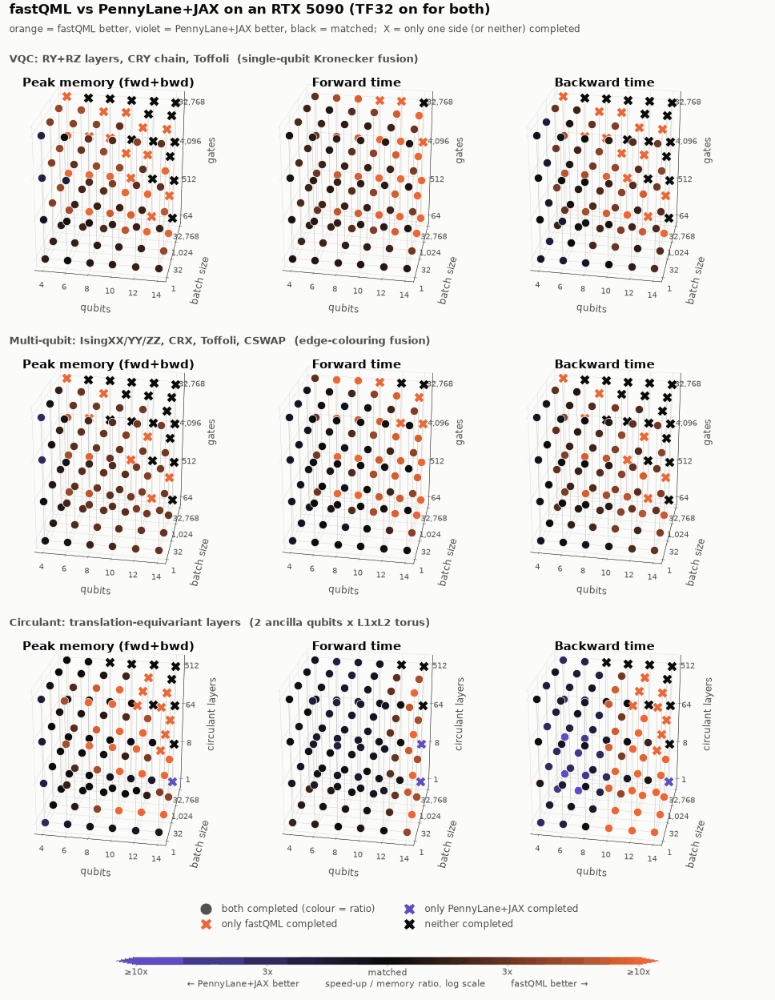

Rotate and hover the points yourself in the
[interactive version](https://htmlpreview.github.io/?https://github.com/ereinha/fastQML/blob/main/docs/benchmarks/interactive_3d.html)
(the same page is [`docs/benchmarks/interactive_3d.html`](https://github.com/ereinha/fastQML/blob/main/docs/benchmarks/interactive_3d.html);
GitHub strips scripts from READMEs, so it cannot run inline). Every number is in
[`docs/benchmarks/points.csv`](https://github.com/ereinha/fastQML/blob/main/docs/benchmarks/points.csv).

<details>
<summary>Static plots: full-resolution panel and the nine individual plots</summary>

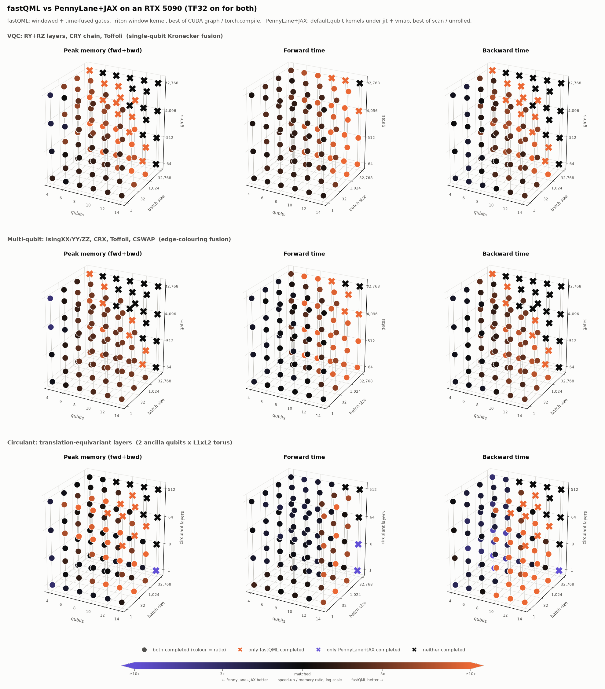

| | Peak memory (fwd+bwd) | Forward time | Backward time |
|---|---|---|---|
| **VQC** | 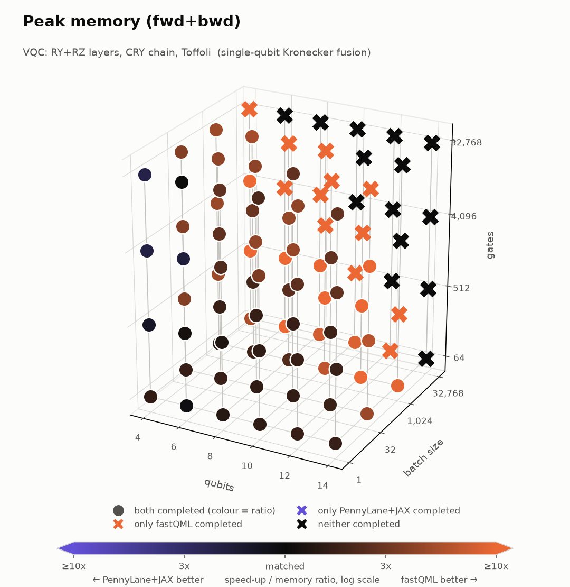 | 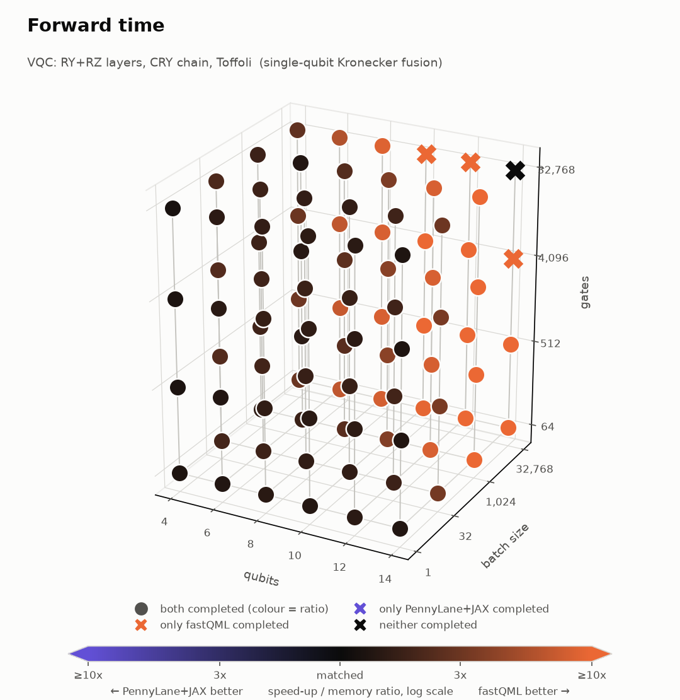 | 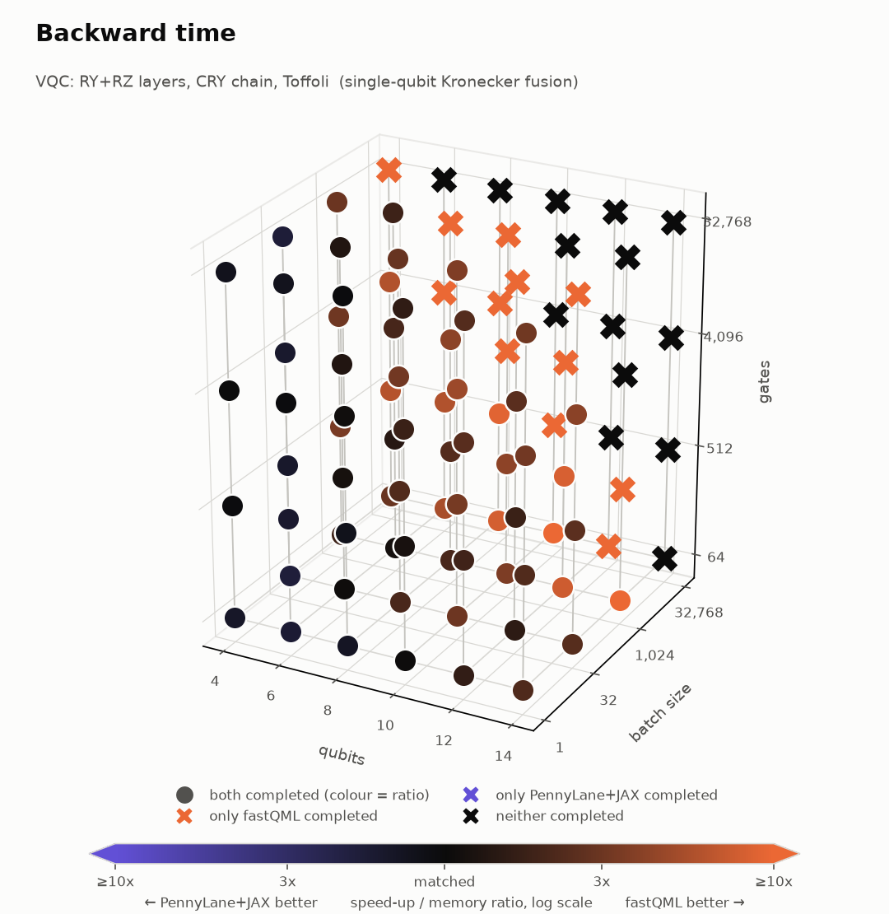 |
| **Multi-qubit** | 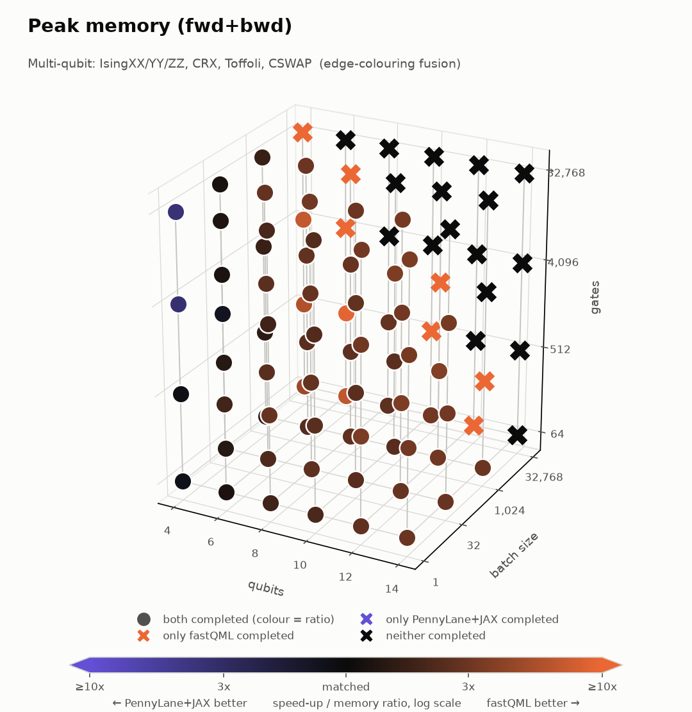 | 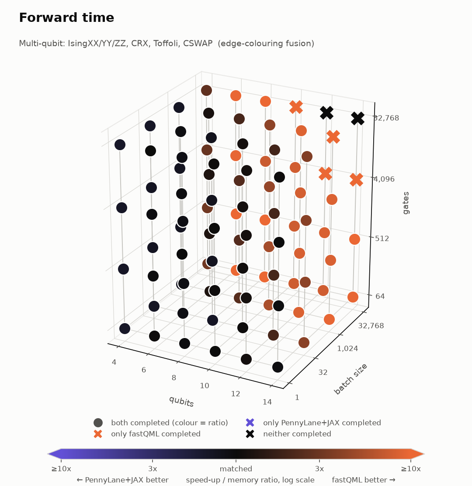 | 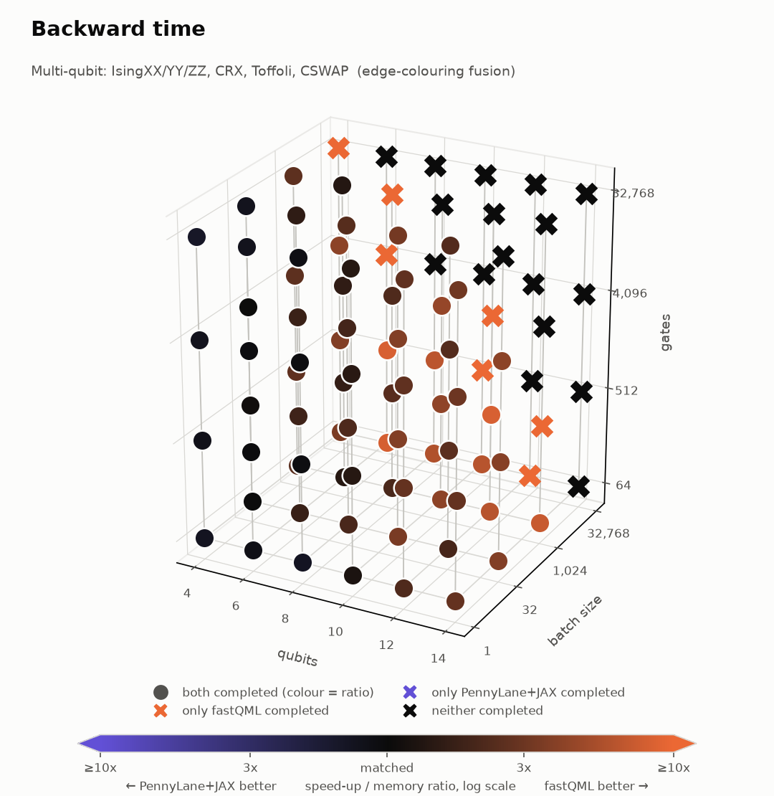 |
| **Circulant** | 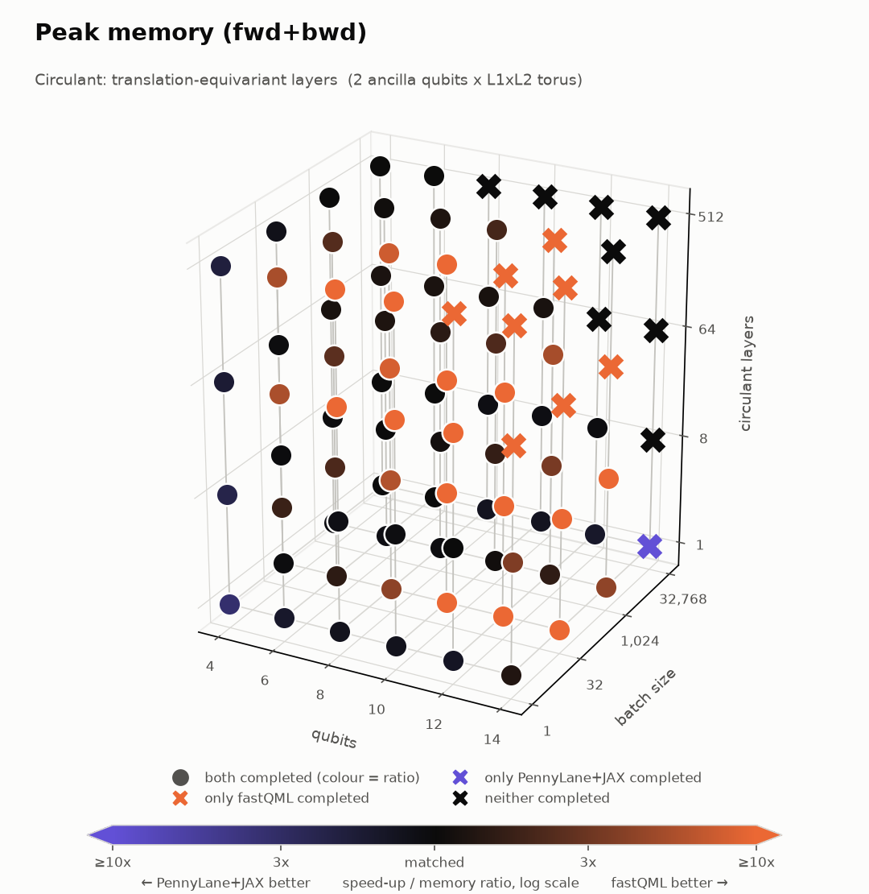 | 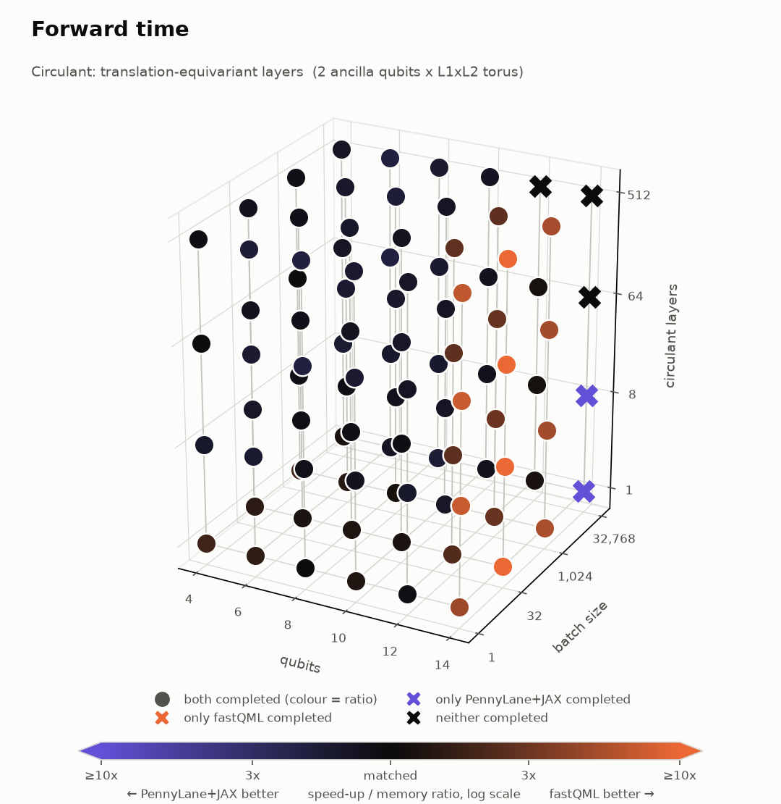 | 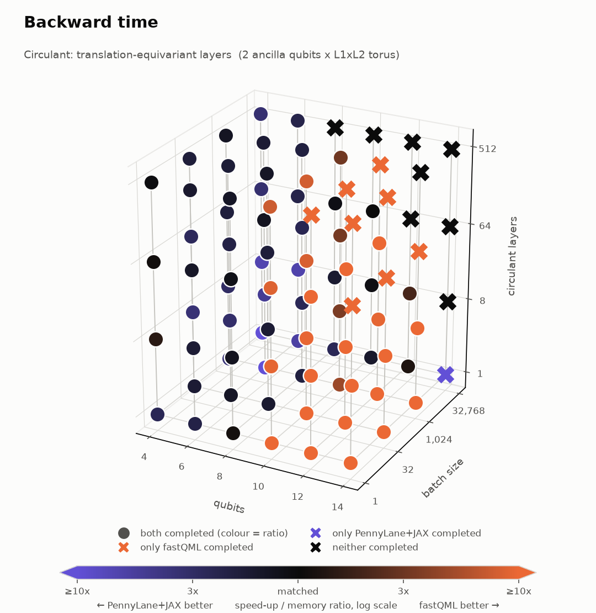 |

</details>

Counting points where both completed and one side is > 1.1x better:

| family | forward | backward | peak memory | only fastQML completed |
|---|---|---|---|---|
| VQC | fastQML 92, JAX 0 (max 15x) | fastQML 52, JAX 11 (JAX max 1.8x) | fastQML 64, JAX 4 | 12 |
| multi-qubit | fastQML 52, JAX 20 (JAX max 1.5x) | fastQML 56, JAX 9 | fastQML 67, JAX 5 | 7 |
| circulant | fastQML 34, JAX 52 (JAX max 2.0x) | fastQML 32, JAX 45 | fastQML 45, JAX 15 | 8 (JAX only: 1) |

Where PennyLane+JAX wins: 4-6 qubits at batch <= 32 (launch-bound; the fused window operators
cost more to build than the passes save, so the per-layer path runs there and is near parity), the
very deepest 4-qubit circuits, and the circulant model below 12 qubits, which uses
`fastqml.circulant`'s unchanged eager einsum chains (its backward at tiny sizes is launch-bound
too). Where fastQML wins: everything from 8 qubits up and every large batch, by 3-15x, and on
memory nearly everywhere; it also completes 26 more training-step points than PennyLane+JAX
before running out of memory. The fused-sequence variant is the winner at the large-batch
points (44 of 288), the per-layer compiled variant elsewhere.

**Precision.** With TF32 on, fastQML's window matmuls round every pass to 10-bit mantissas and
the error compounds with depth: against an fp64 reference, |dP| is ~1e-3 at 500 gates, ~2e-2 at
4000 and useless at 30000 (0.19 on probabilities of 0.2). PennyLane's 1-2-qubit kernels are tiny
einsums that XLA runs in full fp32 regardless of the flag (|dP| 2.5e-5 / 2.6e-4 / 1e-2 at the same
points), so "TF32 on for both" favours fastQML on speed and PennyLane on accuracy. For deep
circuits or when probabilities must be accurate beyond ~1e-3, set
`torch.backends.cuda.matmul.allow_tf32 = False`: the window kernel then runs three-pass TF32
(`tf32x3`, 1e-6-class accuracy, same as fp32 within round-off) and every cuBLAS call runs in fp32.
Measured against an fp64 reference on an 8-layer, 12-qubit chain: relative error 1.1e-2 (TF32) vs
1.2e-6 (`tf32x3`) vs 2.1e-6 (exact fp32 dots) on the state, with matching gradients; against
PennyLane+JAX, fastQML in this mode agrees to 5e-5 (median) over the model grid instead of 1e-3.

The cost of the exact mode, re-running the 36 model points of the table above (both circuits,
8-14 qubits, B 32-32768, 64-4096 gates): forward 1.1-1.6x slower than TF32 at 8 and 14 qubits and
2.7-4.4x at 12 qubits (whose fused windows are the compute-bound 7-qubit ones); forward+backward
1.7-2.6x at most points and up to 5-7x at the largest batches, where the fp32 GEMMs of the gate
gradient dominate. Against PennyLane+JAX (which is effectively fp32 at these settings), fastQML in
exact mode is still faster at 13 of the 22 points both complete (median 1.27x, up to 3.4x), and
within 0.8-1.0x at the rest.

### Register-ops benchmark

`examples/register_ops_bench.py`, RTX 5090, fp32, TF32 off.

Multiplexed RyRz (`B=8192`, `nq=8`, 64 select values), three routes to the identical op:

| Route | ms/call |
|---|---:|
| pure-torch fallback + `torch.compile` | 0.024 |
| `register_ops` Triton (in-place) | 0.109 |
| `register_ops` pure-torch fallback | 0.375 |
| batch-fold + `apply_per_batch_su2_chain` | 10.80 |

In an eager loop, the compiled fallback is fastest (Inductor fuses trig + rotation + stacking into fewer kernels than the hand-written Triton path launches). Inside an outer CUDA graph the ordering flips: capture removes launch overhead for every route, and the in-place Triton kernel's single zero-copy pass wins.

The per-batch-chain route is the only way to express address-indexed angles with gate_fusion primitives; the ~160x gap is permute/copy traffic plus half-a-million tiny batched matmuls, and is the reason the multiplexer exists as its own kernel.

Circulant block apply (`A=4` ancilla channels):

| Lattice | dim | B | dense (4 GEMMs) | k-space | k-space + `torch.compile` |
|---|---:|---:|---:|---:|---:|
| 8x8 | 256 | 8192 | 0.142 ms | 0.831 ms | 0.460 ms |
| 16x16 | 1024 | 1024 | 0.238 ms | 0.858 ms | 0.358 ms |

Dense wins at both sizes on this hardware — the k-space route has ~10x fewer FLOPs but loses to launch/bandwidth overhead at these dims; it is kept for larger registers.

`compose_dense` (8 fixed layers, `nq=8`, `B=8192`): sequential applies 0.874 ms vs composed-once single apply 0.140 ms (**6.2x**) — when parameters are static across many evaluations, compose once and amortize.

### Reproducing

```bash
python examples/minimal_cuda_graph_model.py     # TinyVQC: CPU / CUDA eager / CUDA graph / lightning.qubit
python examples/register_ops_bench.py
python test_window_triton.py                    # Triton window kernel vs cuBLAS windows (CUDA)
```

On Linux/macOS, `torch.compile`'s CPU backend picks up `gcc`/`clang` automatically. On Windows, run from a Visual Studio Developer Command Prompt (or call `vcvars64.bat`) so `cl.exe` is on `PATH`; otherwise the CPU compile path gracefully skips with the error.

---

## Equivalence tests

```bash
python test_pennylane_equivalence.py
```

Output (40 tests, all at fp64 noise floor):

```
=== Single-qubit gates ===
  OK  single-qubit RY/RZ/RX/PhaseShift/H/X/Y/Z/S/T   max |diff| = 0 or ~1e-17
  OK  Rot(phi,theta,omega) per qubit layer           max |diff| = 1.4e-16
  OK  apply_su2_layer (RY then RZ per qubit)         max |diff| = 9.6e-17

=== 2-qubit gates (single) ===
  OK  CRY / CRX / CRZ / CPhase                       max |diff| = 0
  OK  IsingZZ / IsingXX / IsingYY                    max |diff| = 0
  OK  CNOT / CY / CZ / SWAP / ISWAP                  max |diff| = 0

=== 2-qubit gates (multi-pair colors) ===
  OK  3 disjoint CRYs in one color                   max |diff| = 2.8e-17
  OK  chain CRY (3 edges, 3 colors)                  max |diff| = 0
  OK  5 overlapping CPhase (3 colors via diag commute) max |diff| = 6.2e-17

=== Windowed layers (nq > MAX_WINDOW) ===
  OK  apply_su2_layer nq=9 chunked (2 windows)                 max |diff| = 6.5e-17
  OK  4 adjacent CRYs + CRY(1,8) (2 windows, 1 via permute)    max |diff| = 2.9e-17

=== Diagonal layers ===
  OK  build_rz_diag / build_phase_shift_diag                   max |diff| = ~6e-17
  OK  build_ising_zz_diag / cphase / cz (4 overlapping pairs)  max |diff| = ~1e-16

=== Time-fused sequences ===
  OK  fused VQC layer + CRX(0,8) nq=9 (3 windows, 1 long)      max |diff| = 1.1e-16

=== 3-qubit gates ===
  OK  Toffoli, CSWAP, 2 disjoint Toffolis, chain Toffoli   max |diff| = 0

=== Per-batch ===
  OK  apply_per_batch_su2_chain (B=4, nq=5): all batches match
```

The suite also passes with the window size forced down to 3 and 2 qubits (every circuit then
splits into several windows and exercises the permute fallback), which is how the windowed code
paths are covered at the small qubit counts the tests use.

### Register-ops tests

```bash
python test_register_ops.py
```

Output (15 tests; multiplexers checked against explicit fp64 dense references, Triton backward against eager autograd):

```
=== register_ops: multiplexed rotations ===
  OK  mux_ry_rz vs dense reference (nq=5, t=1, S=4)        max |diff| = 2.4e-07
  OK  mux_ry_rz in-place == out-of-place                   max |diff| = 2.4e-07
  OK  mux_ry vs dense reference (nq=5, t=1, S=4)           max |diff| = 1.6e-07
  OK  mux_ry in-place == out-of-place                      max |diff| = 2.4e-07
  OK  mux_ry_rz vs dense reference (nq=8, t=0, S=64)       max |diff| = 3.3e-07
  OK  mux_ry_rz in-place == out-of-place                   max |diff| = 3.6e-07
  OK  triton fwd == eager fwd (nq=8, S=64)                 max |diff| = 4.8e-07
  OK  mux_ry_rz autograd d_re/d_im/d_ty/d_tz (triton bwd vs eager autograd)  max |diff| = 7.2e-07
=== register_ops: dense composition ===
  OK  compose_dense == sequential apply_dense              max |diff| = 7.2e-07
=== circulant ===
  OK  circulant_dense unitary for unitary U(k) (L=4x4, A=4) max |diff| = 3.2e-08
  OK  circulant dense apply == k-space apply               max |diff| = 7.2e-07
  OK  circulant commutes with lattice translations         max |diff| = 7.2e-07

15/15 passed
```

---

## Conventions

**State layout.** A state on `nq` qubits is a pair `(re, im)` of float tensors with shape `(B, 2, 2, ..., 2)` — one batch axis and `nq` qubit axes. Axis 1 is qubit 0 (the MSB of the flat basis index), matching PennyLane's default `qml.state()` ordering.

**Gate matrices.** All gate builders return `(G_re, G_im)`. Single-qubit shape: `(nq, 2, 2)` for layer apply, `(B, nq, 2, 2)` for per-batch chains. Two-qubit: `(n_pairs, 4, 4)`. Three-qubit: `(n_triples, 8, 8)`.

**Two-qubit basis.** `(c, t)` with `c` as MSB, so the 4-state basis order is `|c=0,t=0>, |c=0,t=1>, |c=1,t=0>, |c=1,t=1>`. For CRY/CRX/CRZ the matrix is identity on `|c=0>...`, the rotation on `|c=1>...`.

**Three-qubit basis.** `(q1, q2, q3)` with `q1` as MSB; the 8-state basis order matches.

**Windows.** A window is a contiguous block of `w` state axes (qubits `start .. start+w-1`); its
operator is `2^w x 2^w` in ascending-qubit basis order. `gate_fusion.MAX_WINDOW` (7) caps `w`;
windows narrower than `MIN_WINDOW` (4) are padded with identity qubits. A gate whose qubits span
more than `MAX_WINDOW` positions is applied by permuting its qubits to the front, applying it as a
window there, and permuting back. Layers on <= 8 qubits stay a single window on the cuBLAS path;
with the Triton kernel active, nq = 8 splits into 4 + 4.

**Sequences.** `compile_sequence(gates, ...)` takes `[(gate_id, qubits)]` in application order,
`qubits` in the gate's basis order. `apply_sequence(re, im, plan, mats)` takes `mats[gate_id] =
(G_re, G_im)`. Open windows in the planner always have disjoint qubit ranges, which is what makes
emitting them in any order correct; gates are never reordered past a gate they don't commute with.

**Diagonal layers.** `build_*_diag` return `(d_re, d_im)` of length `2^nq` (the product of all the
layer's phases, overlapping qubits allowed since diagonal gates commute); `apply_diagonal_layer`
multiplies elementwise.

**register_ops layout.** Multiplexer state is flat `(B, 2^nq)` with qubit 0 as MSB. `apply_mux_ry(re, im, angles, target, nq, select_bits)`: angles have shape `(B, 2^select_bits)` and are indexed by the lowest `select_bits` bits of the basis address; the select bits must lie below the target qubit (other layouts reduce to this by a basis permutation). In-place variants (`apply_mux_ry_`, `apply_mux_ry_rz_`) skip autograd for sampling-style loops. `circulant` register index is `a * N + site` with sites row-major on the `L1 x L2` torus; momentum blocks `Uk` have shape `(L1, L2, A, A)`.

**Commutation predicates.** Used by the edge-coloring algorithms to decide when reordering across colors is safe.
- `cry_commute(e1, e2)` — CRX/CRY/CRZ family: don't commute when one's target is the other's control
- `diagonal_commute(e1, e2)` — CZ/CPhase/IsingZZ: always commute (just need disjoint qubits within a color)
- `symmetric_commute(e1, e2)` — SWAP/ISWAP/IsingXX/YY: don't commute when sharing any qubit
- `toffoli_commute(t1, t2)` — Toffoli: target of one ↔ any control of the other
- `cswap_commute(t1, t2)` — share any qubit ⇒ don't commute

Pick the right predicate when calling `compute_two_qubit_plans(...)` / `compute_three_qubit_plans(...)` for your gate. (`compile_sequence` needs none: it never reorders non-adjacent gates.)

---

## Citation

If you use fastQML in published research, please cite it:

```bibtex
@software{Reinhardt_fastQML_2026,
  author  = {Reinhardt, Eric A. F.},
  title   = {{fastQML}: Fast {PyTorch} quantum-circuit primitives via {K}ronecker-product layer fusion},
  year    = {2026},
  version = {0.3.0},
  url     = {https://github.com/ereinha/fastQML}
}
```

The multiplexed rotation is the uniformly controlled rotation of quantum-circuit synthesis (Mottonen, Vartiainen, Bergholm & Salomaa, PRL 93, 130502, 2004; Shende, Bullock & Markov, IEEE TCAD 25, 1000, 2006). The optional Triton kernels use Triton (Tillet, Kung & Cox, MAPL 2019). Gate fusion in statevector simulation follows the lineage of qHiPSTER (Smelyanskiy et al., arXiv:1601.07195), Haner & Steiger (SC'17, arXiv:1704.01127) and qsim (Isakov et al., arXiv:2111.02396); the equivalence tests and benchmarks use PennyLane (Bergholm et al., arXiv:1811.04968) and TorchQuantum (Wang et al., HPCA 2022, arXiv:2107.10845).

A machine-readable [`CITATION.cff`](https://github.com/ereinha/fastQML/blob/main/CITATION.cff) is also included — GitHub renders a "Cite this repository" button on the repo page that copies the citation in BibTeX, APA, or other formats.

## License

MIT — see [`LICENSE`](https://github.com/ereinha/fastQML/blob/main/LICENSE).

## Limitations

- **Per-batch unitaries don't fuse.** When a layer's gate angles depend on per-batch quantities (e.g. data re-uploading), `apply_per_batch_su2_chain` falls back to a sequential per-qubit batched matmul. When the data-dependent angle is indexed by basis-address bits rather than free per batch element, use `register_ops.apply_mux_ry` / `apply_mux_ry_rz` instead.
- **Fused sequences pay a build cost per window.** The window operator is a chain of small (<= 256x256) complex products, rebuilt every forward because the gates are parametric. Below a batch of a few dozen states that build costs more than the passes it saves (~1.5x slower than the per-layer API at B = 32); above it, the fused path is 2-3x faster.
- **The Triton window kernel is CUDA fp32 only.** fp64, CPU and non-Triton installs use the cuBLAS/torch window path (same results, ~2.5x more memory traffic per pass on GPU).
- **Gates wider than 7 qubits need a permute pass** each way (two extra passes over the state).
- **Windows CPU `torch.compile` needs MSVC.** Install Visual Studio Build Tools' C++ workload, then run from a Developer Command Prompt (or `vcvars64.bat`-load the env). Linux/macOS work with their default `gcc`/`clang`.
- **Inductor's auto-CUDA-graph (`reduce-overhead` mode) is disabled** in `fastqml.gate_fusion` (`torch._inductor.config.triton.cudagraphs = False`) so that an outer `make_graphed_callables` / `torch.cuda.graph` capture owns the graph. Compile the per-layer function and capture the whole forward yourself; that combination is what the benchmarks use.
